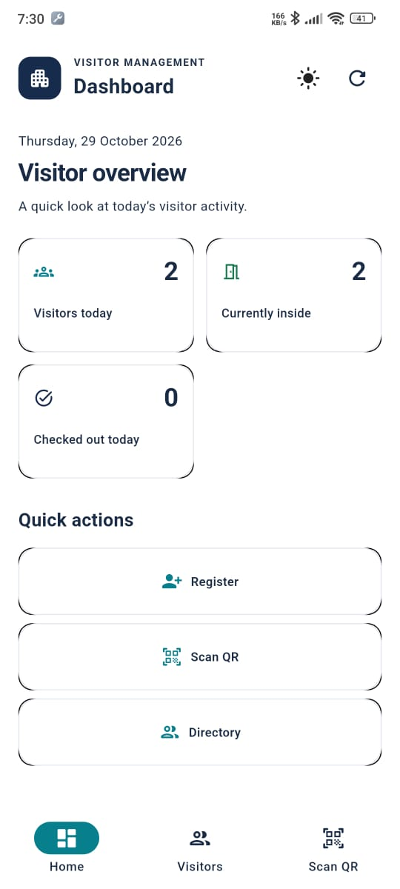
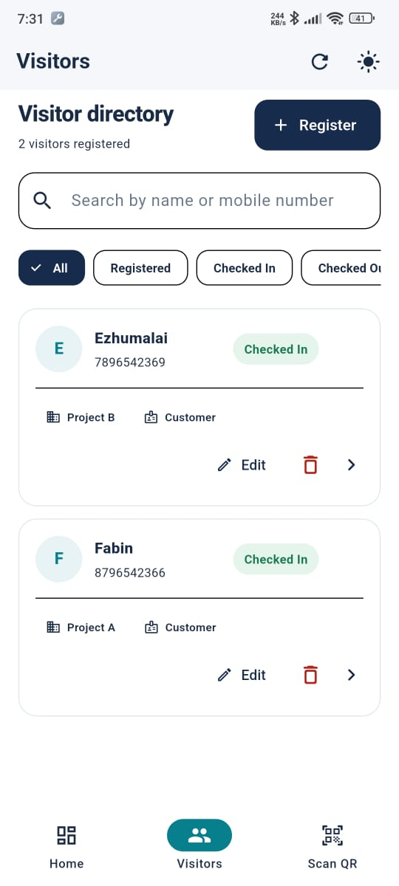
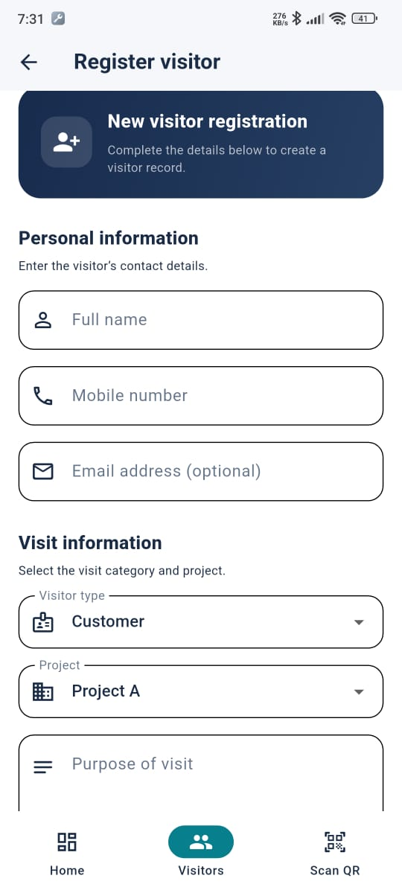
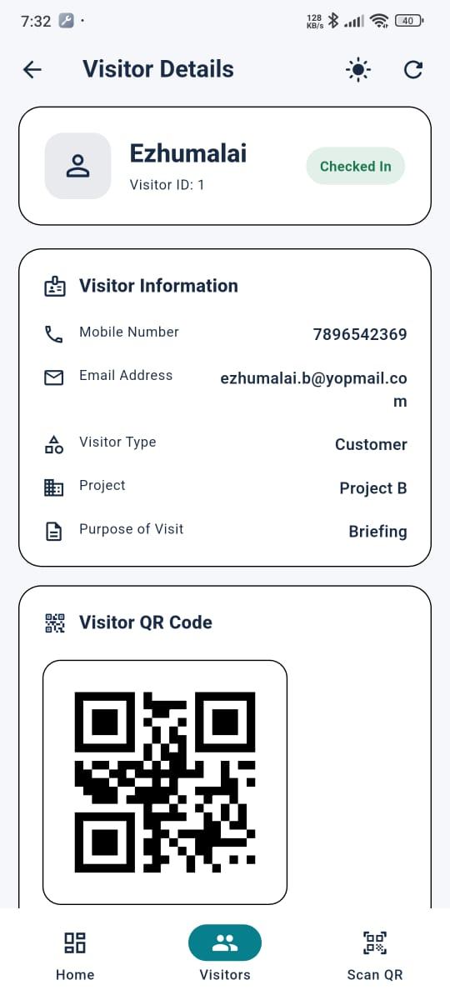
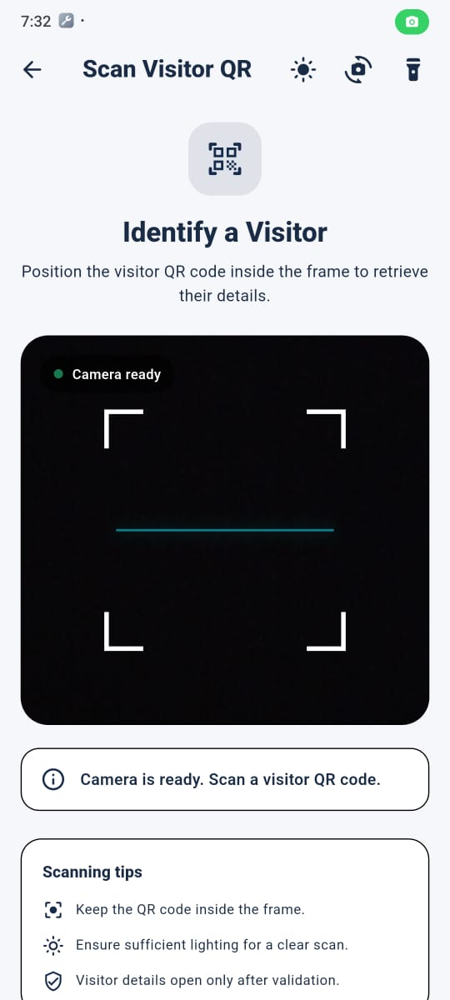

# Visitor Management App

A Flutter mobile application for registering visitors, managing visitor records, generating and scanning QR codes, and recording visitor check-in and check-out activities.

This project is developed as a Flutter Developer practical assignment. It uses a mock REST API for visitor data and focuses on clean UI, CRUD operations, state management, reusable components, and maintainable application architecture.

## Features

### Dashboard
- View visitors registered today.
- View visitors currently checked in.
- View visitors checked out today.
- Navigate to visitor registration, the visitor directory, and QR scanning.
- View recent visitor records.

### Visitor Registration and Management
- Register visitors with personal and visit details.
- Edit existing visitor information.
- View visitor details.
- Search by visitor name or mobile number.
- Filter records by visitor status.
- Delete visitors after confirmation.
- Display loading, empty, success, and error states.

### QR Code
- Generate a QR code using the visitor's unique ID.
- Display the QR code on the visitor details screen.
- Scan QR codes using the device camera.
- Retrieve visitor information using the scanned ID.
- Handle invalid QR values and lookup failures.

### Check-in and Check-out
The intended visitor workflow is:

`Registered → Checked In → Checked Out`

- Record check-in and check-out timestamps.
- Update visitor status through the REST API.
- Prevent invalid status transitions through application logic.

### User Interface
- Responsive layouts for common mobile screen sizes.
- Light and dark themes.
- Reusable visitor status, loading, empty, and error widgets.
- Form validation and user feedback.
- GoRouter navigation.
- Camera permission handling and retry options.

> Features should be considered complete only after their behavior has been verified against the running application and API.

## Technology Stack

| Technology | Version / Configuration | Purpose |
|---|---|---|
| Flutter | SDK constraint not specified by the supplied `pubspec.yaml` | Mobile application framework |
| Dart | `^3.13.3` SDK constraint | Application language |
| `flutter_riverpod` | `^3.4.3` | Flutter state management |
| `riverpod` | `^3.4.3` | State management |
| `dio` | `^5.11.1` | HTTP requests |
| `go_router` | `^18.1.1` | Navigation |
| `mobile_scanner` | `^7.4.2` | QR scanning |
| `qr_flutter` | `^4.1.0` | QR code generation |
| `app_settings` | `^9.0.1` | Device settings access |
| `cupertino_icons` | `^1.0.8` | Cupertino icons |
| `flutter_lints` | `^6.0.0` | Dart and Flutter lint rules |
| `flutter_launcher_icons` | `^0.14.4` | Application icon configuration |

The versions above are taken from the supplied `pubspec.yaml`. The exact installed Flutter and Dart SDK versions should be confirmed using `flutter --version`.

## Architecture

The application uses a layered structure to separate the user interface, application logic, domain rules, and API access.

```text
lib/
├── app.dart
├── main.dart
├── core/
│   ├── config/
│   ├── errors/
│   ├── navigations/
│   ├── network/
│   ├── providers/
│   ├── theme/
│   └── widgets/
├── data/
│   ├── datasources/
│   ├── models/
│   └── repositories/
├── domain/
│   ├── entities/
│   ├── repositories/
│   └── usecases/
└── presentation/
    ├── screens/
    ├── viewmodels/
    └── providers/
```

This is a high-level representation of the architecture discussed during development. Confirm directory names against the final project before submission.

### Layer responsibilities

- **Presentation:** Screens, forms, navigation interactions, and reusable UI.
- **ViewModels:** Application actions, visitor state, filtering, and status updates.
- **Domain:** Visitor entities, repository contracts, and use cases.
- **Data:** API data sources, JSON models, and repository implementations.
- **Core:** Network configuration, routing, theme, error handling, and shared widgets.

### Why Riverpod?

Riverpod is used to manage application state and separate UI rendering from application operations.

The visitor ViewModel exposes visitor data and state, including loading status, error messages, success messages, search queries, and status filters. Screens can observe shared state rather than maintaining independent copies of visitor records.

This approach helps keep visitor details, the visitor directory, and dashboard information consistent when records are updated. The actual synchronization behavior must still be verified through testing.

## Prerequisites

Install the following before running the project:

- Flutter SDK compatible with the project's Dart SDK constraint.
- Android Studio or Visual Studio Code.
- Android SDK and an emulator or physical Android device.
- Internet connectivity for the mock REST API.
- Git, if cloning the repository.

Check your development environment:

```bash
flutter doctor
flutter --version
dart --version
```

## Installation and Setup

### 1. Clone the repository

```bash
git clone <your-repository-url>
cd visitor_management_app
```

Replace `<your-repository-url>` with the actual Git repository URL.

### 2. Install dependencies

```bash
flutter pub get
```

### 3. Configure the mock API

The application should use the base URL configured in its existing application configuration or API service.

**Current API configuration to verify:**

```text
https://6ae0828fbe3bc8fead975f43.mockapi.io/visitor-mgmt/api/v1
```

The visitor collection endpoint is expected to be:

```text
/visitors
```

Before evaluation, confirm that this URL matches the current `AppConfig` or API service in the final source code and that the API remains available.

No separate backend application is required by the assignment.

### 4. Run the application

```bash
flutter run
```

To run on a connected Android device, first verify that the device is detected:

```bash
flutter devices
```

### 5. Analyze and test

Run static analysis:

```bash
flutter analyze
```

Run automated tests:

```bash
flutter test
```

These commands describe the verification process; passing results have not been confirmed in this README.

## REST API Integration

The application uses Dio for asynchronous HTTP communication. API requests should remain in the networking and data-access layers rather than being implemented directly inside screen widgets.

### Visitor endpoints

| Method | Endpoint | Purpose |
|---|---|---|
| GET | `/visitors` | Retrieve visitor records |
| GET | `/visitors/{id}` | Retrieve one visitor |
| POST | `/visitors` | Register a visitor |
| PUT | `/visitors/{id}` | Update visitor information |
| DELETE | `/visitors/{id}` | Delete a visitor |

The actual HTTP method and response structure must match the configured mock API. Check-in and check-out updates use the existing visitor update flow; confirm the exact request method and payload in the final implementation.

### Visitor data model

| Field | Description |
|---|---|
| `id` | Unique visitor identifier generated by the API |
| `name` | Visitor name |
| `mobile` | Mobile number |
| `email` | Optional email address |
| `visitor_type` | Customer, Vendor, or Other |
| `project` | Project A, Project B, or Project C |
| `purpose` | Purpose of the visit |
| `status` | Registered, Checked In, or Checked Out |
| `created_at` | Visitor registration timestamp |
| `check_in_time` | Check-in timestamp, if available |
| `check_out_time` | Check-out timestamp, if available |

The Dart model uses corresponding application properties and maps JSON keys such as `visitor_type`, `created_at`, `check_in_time`, and `check_out_time`.

### Sample visitor JSON

```json
{
  "id": "VIS001",
  "name": "Rahul Sharma",
  "mobile": "9876543210",
  "email": "rahul@example.com",
  "visitor_type": "Customer",
  "project": "Project A",
  "purpose": "Site Visit",
  "status": "Registered",
  "created_at": "2026-10-26T10:00:00+05:30",
  "check_in_time": null,
  "check_out_time": null
}
```

This is an illustrative record based on the assignment's sample format, not a claim that the live API currently contains this record.

## Application Workflow

1. Open the dashboard and review visitor statistics.
2. Register a new visitor or open the visitor directory.
3. Select a visitor to open their details.
4. Edit or delete the record as required.
5. Generate and display the visitor's QR code using the server-generated ID.
6. Scan a visitor's QR code to retrieve their details.
7. Check in a registered visitor.
8. Check out a checked-in visitor.
9. Refresh the relevant screens and verify that updated data is reflected.

## Validation and Business Rules

The application should follow these assignment rules:

- Visitor name is required.
- Mobile number is required and must contain exactly 10 digits.
- Email is optional but must be valid when provided.
- Visitor type and project must use the specified dropdown options.
- Purpose of visit is required.
- New visitors start with `Registered` status.
- Check-in is permitted only for registered visitors.
- Check-out is permitted only for checked-in visitors.
- A visitor cannot check in twice or check out before checking in.
- Completed visits cannot be checked in again.
- QR scanning must handle invalid values, missing visitors, and repeated callbacks safely.
- Dashboard metrics should use the device's local date consistently.

Verify each rule against the final code and live API before claiming full compliance.

## Error Handling

The application includes shared loading and error presentation patterns and uses a central API service to handle request failures.

During testing, verify these scenarios:

- Network unavailable or request timeout.
- API returns an unsuccessful HTTP status.
- Visitor record does not exist.
- API response contains an unexpected structure or missing ID.
- QR code contains an invalid value.
- Camera permission is denied.
- Form validation fails.
- Check-in or check-out update fails.

The app should provide understandable feedback instead of crashing or displaying a blank screen.

## Screenshots

Add screenshots of the actual running application before submitting the repository.

Recommended folder structure:

```text
screenshots/
├── dashboard.png
├── visitor_list.png
├── visitor_registration.png
├── visitor_details_qr.png
└── qr_scanner.png
```

After capturing the screenshots, add them to this README:

```markdown
## Screenshots

### Dashboard


### Visitor List


### Visitor Registration


### Visitor Details and QR Code


### QR Scanner

```

These image paths are placeholders until the screenshots have been added to the repository.

## Testing Checklist

Before submitting, verify the following manually or with automated tests.

- [ ] Application launches on an Android device.
- [ ] Visitor records load from the API.
- [ ] Registration validates required fields.
- [ ] Mobile number validation enforces exactly 10 digits.
- [ ] Visitor creation returns and stores a valid server-generated ID.
- [ ] Editing updates the existing API record.
- [ ] Deletion requires confirmation and removes the record.
- [ ] Search works by visitor name and mobile number.
- [ ] QR generation uses the correct visitor ID.
- [ ] QR scanning retrieves the correct visitor.
- [ ] Invalid QR codes and missing visitors show meaningful errors.
- [ ] Repeated scanner callbacks do not trigger duplicate operations.
- [ ] Check-in and check-out enforce the correct status transitions.
- [ ] Visitor changes persist after restarting the application.
- [ ] Dashboard counts use local dates and update after status changes.
- [ ] Loading, empty, network-error, and validation states work.
- [ ] Camera permission denial is handled gracefully.
- [ ] Forms remain usable when the keyboard is visible.
- [ ] `flutter analyze` and `flutter test` have been run.

## Known Limitations and Verification Notes

The following items must be confirmed before the README is considered final:

- The configured mock API URL must be checked against the current source and tested for availability.
- API persistence across application restarts must be verified.
- Visitor ID mapping must be confirmed against the actual API response.
- Dashboard counts must be checked against the complete dataset returned by the API.
- Automated test and static-analysis results have not been confirmed here.
- The final screenshots, APK, and repository URL must be added before submission.

Update this section to reflect the actual results of your final testing.

## Build an Android APK

When the application has been tested successfully, create a release APK:

```bash
flutter build apk --release
```

The APK is normally generated at:

```text
build/app/outputs/flutter-apk/app-release.apk
```

Install and test the release APK on a physical Android device before submission. Confirm that the configured API is accessible from the device.

## Assignment Deliverables

Prepare the following for evaluation:

1. Complete Flutter source code and Git repository.
2. Installable Android release APK.
3. This README with verified configuration details.
4. Screenshots of all five required screens.
5. Working mock API information and sample data.
6. A successful demonstration of registration, CRUD operations, QR scanning, and check-in/check-out.

## License

No license has been specified in the supplied project configuration. Add an appropriate license if required for publication or distribution.
